# UI cleanup — 2026-10-18

Implemented the approved six-part cleanup. These are captures of the local frontend at port 5171. Authenticated screens use intercepted local REST/WebSocket fixtures with synthetic `.test` accounts and submissions; they do not establish production behavior. The browser run uses the supported sans-serif fallback for the Google Fonts stylesheet, so it does not depend on that external font service.

## Landing and current-system copy

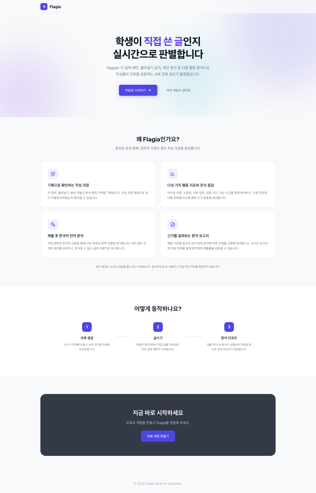

- The top-right login/register actions and live-verification badge are removed. The hero's main entry buttons remain.
- “Why Flagia?” now describes recorded writing/replay, five behavioral indicators and transcription checks, asynchronous Korean language analysis, and evidence-based teacher review. It explains the limits of a score.
- The feature icons share one restrained accent treatment and adapt to the theme.
- Also checked [English/dark desktop](walkthrough-assets/ui-cleanup-landing-en-dark-desktop.png), [Korean/light mobile](walkthrough-assets/ui-cleanup-landing-ko-light-mobile.png), and [English/dark mobile](walkthrough-assets/ui-cleanup-landing-en-dark-mobile.png).

## Registration and shared icon system

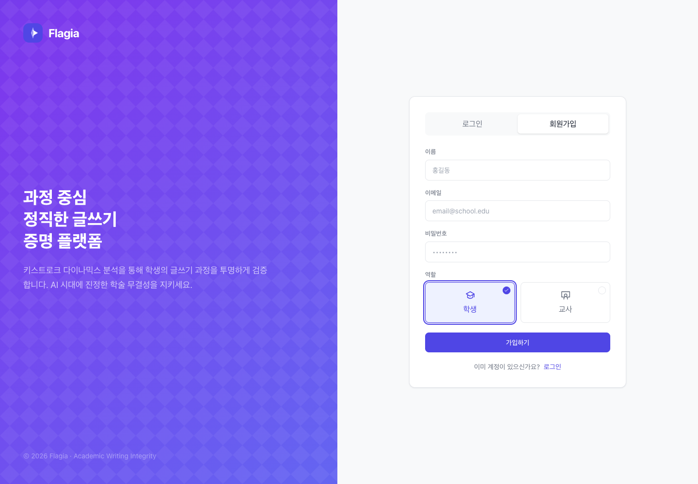

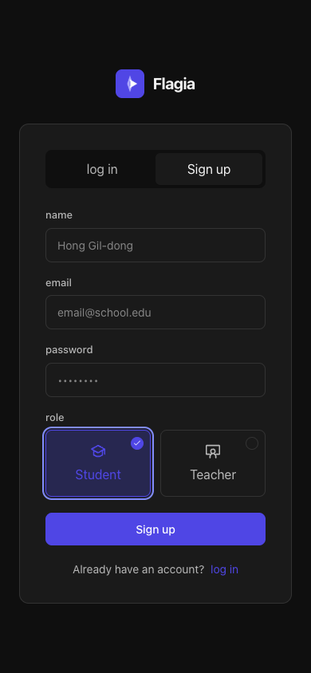

- All three promotional pills are removed from the authentication panel.
- Student/teacher choices use SVG icons, visible selection indicators, and `aria-pressed`. Keyboard selection and focus remain available; the mobile layout fits without clipping.
- A locally intercepted registration request retained the selected `TEACHER` role without creating an account.
- Navigation, empty/error/success states, dialogs, metadata, analysis cards, and replay controls use the shared SVG system or plain labels. Korean and English UI labels contain no decorative emoji.

## Settings and typography

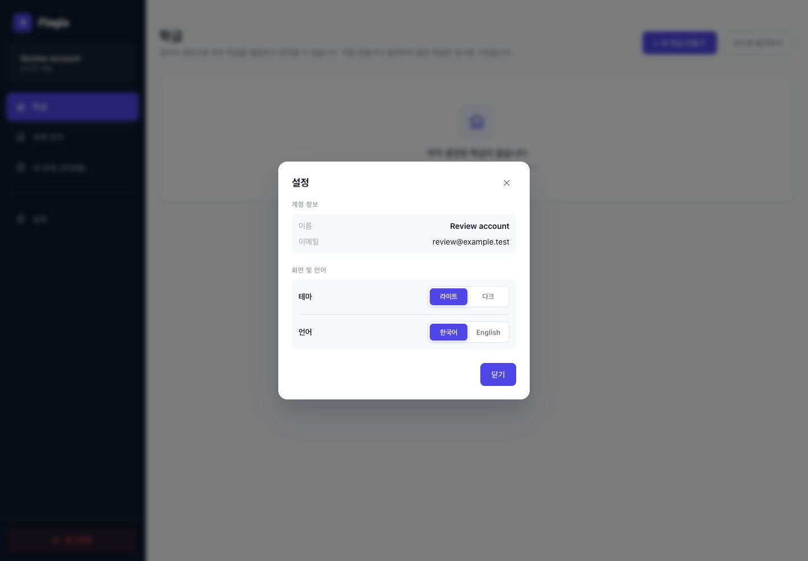

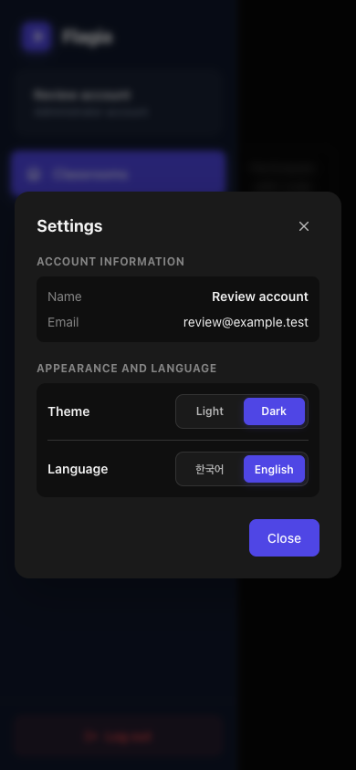

- Settings contains name, email, theme, and language; the complete role row is removed.
- JetBrains Mono and Fira Code references, the JetBrains font download, and UI monospace styling are removed. Scores and timers use sans-serif tabular numerals. Code blocks also inherit the sans-serif family.
- Theme and language changes persist after reload. All four desktop/mobile locale/theme combinations passed the settings and horizontal-overflow checks.
- [Classroom member emails](walkthrough-assets/ui-cleanup-classroom-member-email.png) use the same sans-serif typography.

## Reports, replay, and loading transitions

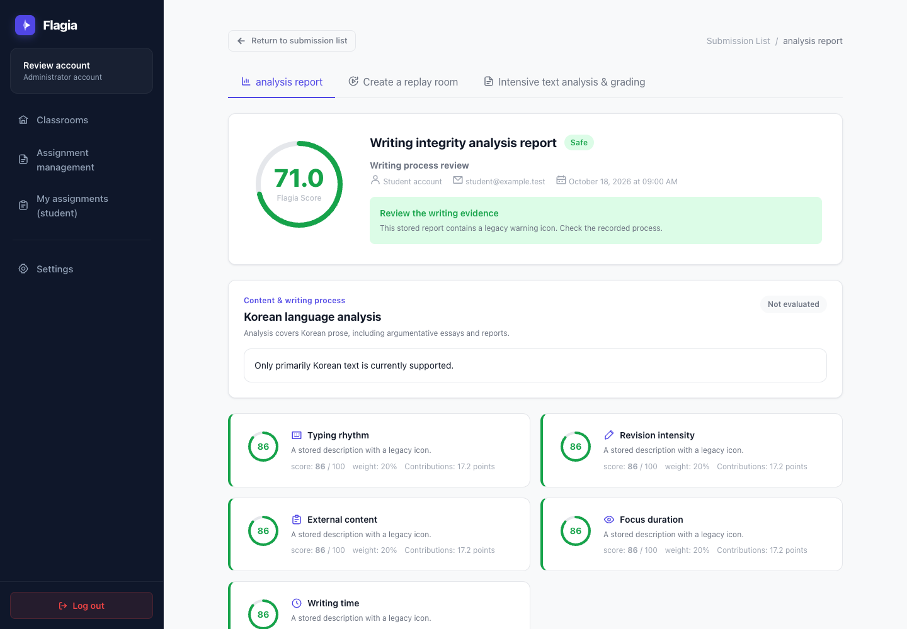

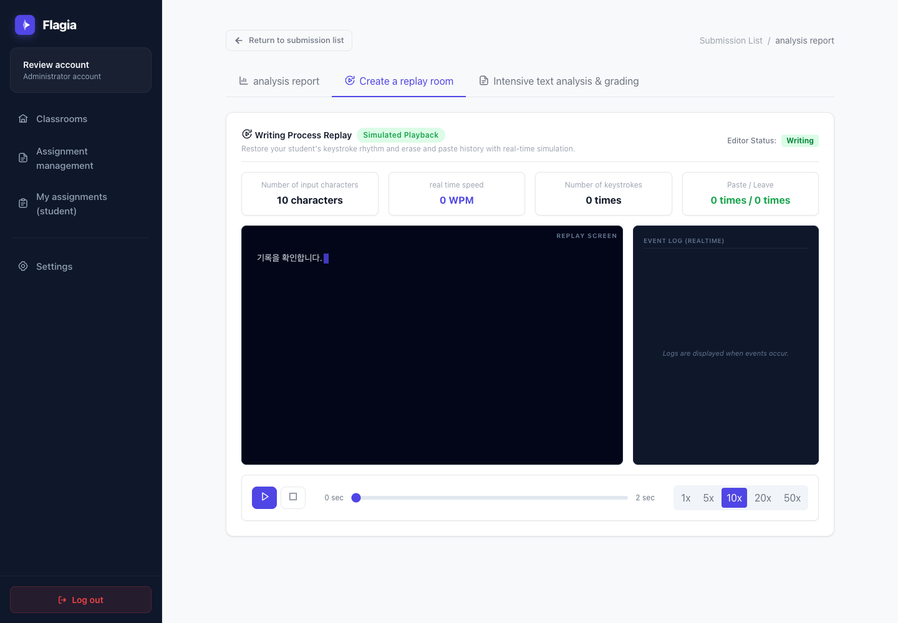

- Legacy server-generated report prose is normalized only at the presentation boundary. Test descriptions and verdicts originally contained emoji; the visible report does not.
- Follow-up, corrected per user clarification: metric icons match their heading text color. Local fixtures covering all three statuses verified identical icon/heading colors across five cards in both light and dark themes; the production build passed.

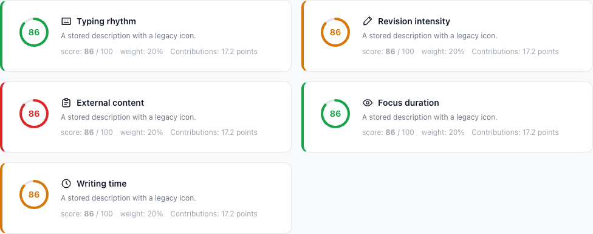

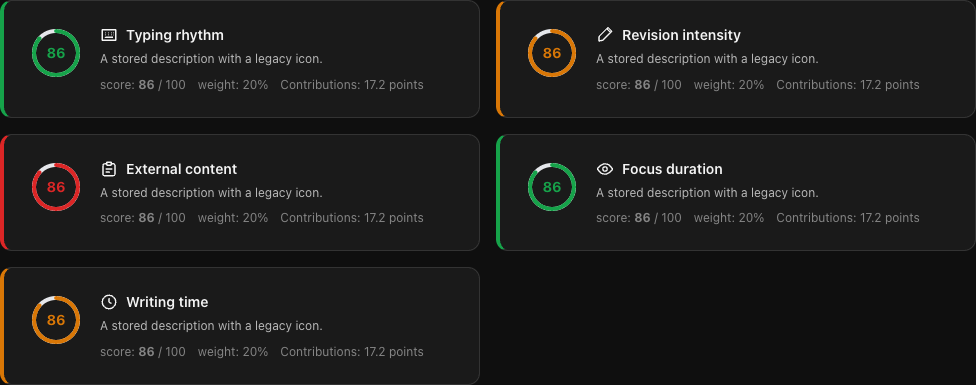

- Student-written emoji survive document display and replay unchanged. Telemetry, original submission text, scoring, and stored analysis are not rewritten.
- Visual checks exposed a route transition race: replacing the loading root with the report root could leave `fade-enter-from` at opacity zero, even after animation frames, with no active animation. Animating a stable keyed wrapper in the authenticated layout fixes this. The final captures wait for transition classes to clear.
- Also verified the [error state](walkthrough-assets/ui-cleanup-analysis-error.png), [delete dialog](walkthrough-assets/ui-cleanup-delete-classroom-dialog.png), and [empty classroom state](walkthrough-assets/ui-cleanup-empty-classrooms-en-dark-desktop.png).

## Verification

- Production type check and frontend build passed.
- Existing Korean/IME replay frame regressions passed.
- `node tests/systemText.test.ts` passed, covering legacy icon removal and preservation of student-authored emoji in document frames.
- [24 browser assertions](walkthrough-assets/ui-cleanup-checks.json) passed, including registration role payload, keyboard selection, preference persistence, typography, emoji, horizontal-overflow, report, and replay checks. No unexpected browser warnings or errors were recorded; the registration/error fixtures deliberately return 400/404 responses.
- Source audit found no developer-owned emoji or monospace declarations/classes in frontend source. Final scoped whitespace and sensitive-data reviews passed.
- Local verification only; no production deployment was performed.

---

# Exact Korean/IME replay walkthrough

## Student source document

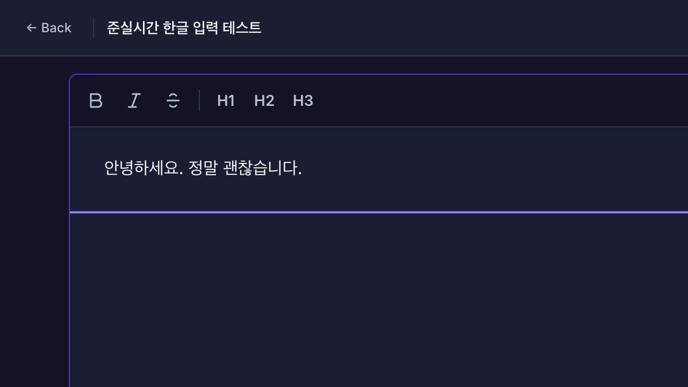

- The connected student editor finished with `안녕하세요. 정말 괜찮습니다.`.
- The browser flow exercised Korean insertion, deletion, full-range selection,
  replacement, and final submission.
- The mock protocol captured 21 authoritative v3 document frames. Every frame
  included a compact text patch plus its post-transaction cursor and selection.
- Two frames recorded full-document selections (`selectionLength` 15 and 14),
  proving that selection-only transactions are preserved instead of forcing the
  replay cursor to the document end.
- The final periodic snapshot, live teacher relay, and submitted source all
  matched the same Korean text.

## Replay start

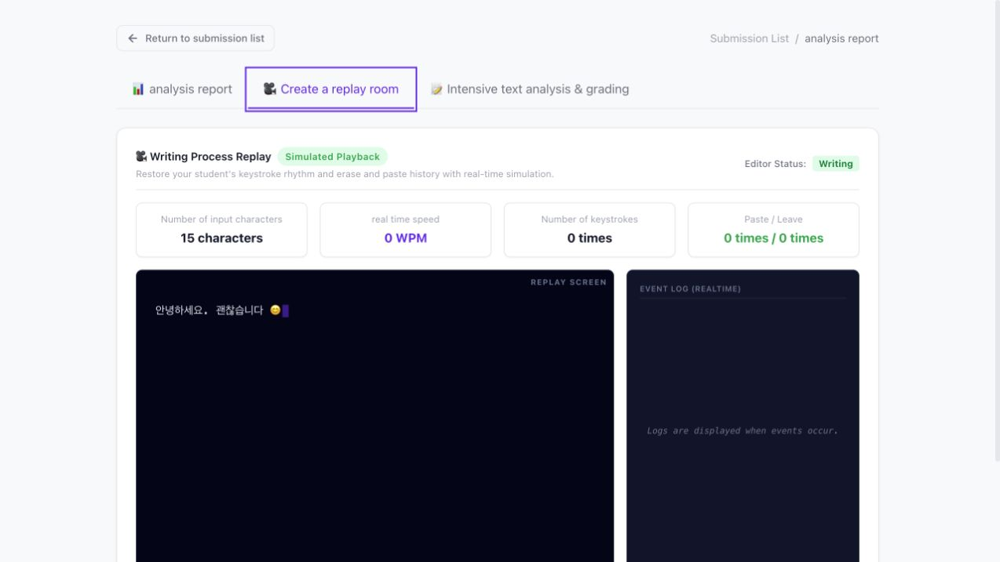

- At timeline start, replay renders the first stored editor state immediately.
- The caret comes from the recorded frame rather than the legacy Hangul
  automaton or a 2-second snapshot approximation.

## Replay completion

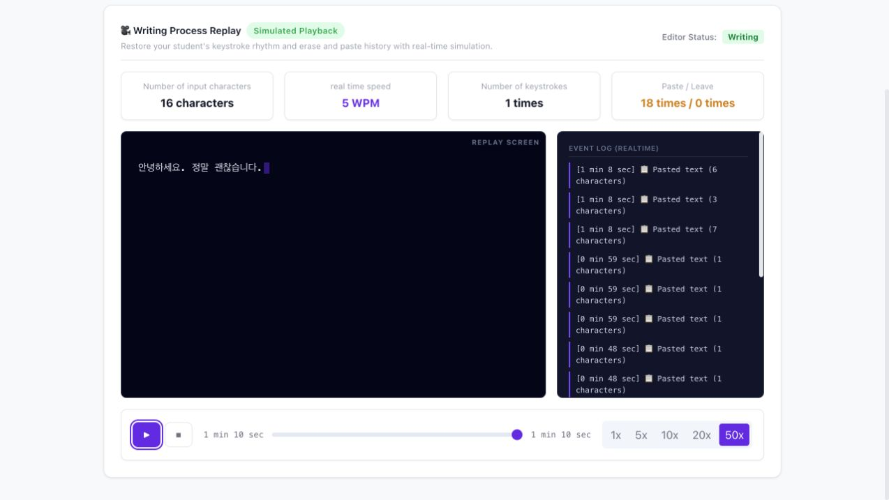

- Playback at 50× traversed the complete recorded timeline and ended at
  `안녕하세요. 정말 괜찮습니다.`.
- The final replay frame exactly matched the submitted document.
- The browser controller injects text through paste-like browser input, so the
  paste counter in these visual fixtures is not representative of a physical
  keyboard. Deterministic replay tests separately cover intermediate Hangul
  composition states, compound vowels/final consonants, Backspace, mid-document
  replacement, mixed Korean/English/emoji, snapshot recovery, and legacy
  fallback detection.

## Verification

- Frontend `test:replay` passed.
- Frontend production type-check and build passed.
- Backend document-frame validation test and production build passed.
- `git diff --check` passed.

---

# Theme, language, and app-shell walkthrough

## Settings — Korean light theme

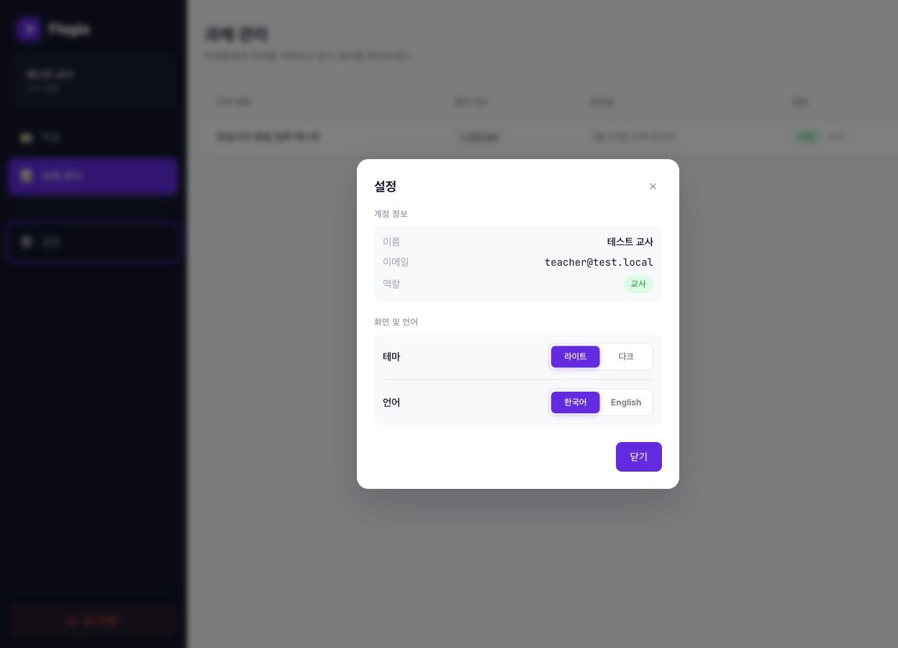

- The former Security section is removed.
- Settings now contains account information, Light/Dark theme controls, and Korean/English language controls.
- Theme and language changes apply immediately and persist after reload.

## Settings — English dark theme

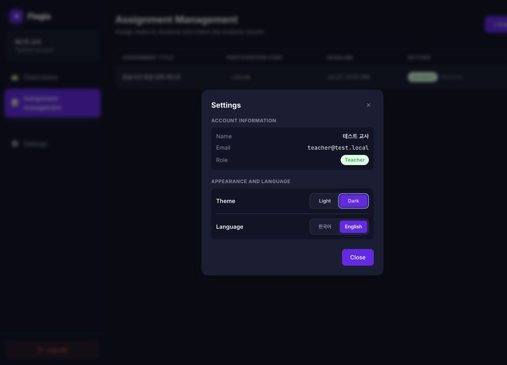

- Neutral surfaces, borders, shadows, and text use the complete dark palette.
- Flagia purple and green integrity/status semantics remain unchanged.
- The document reports `data-theme="dark"` and `lang="en"` after selection and after reload.

## Mobile shell without the white logo bar

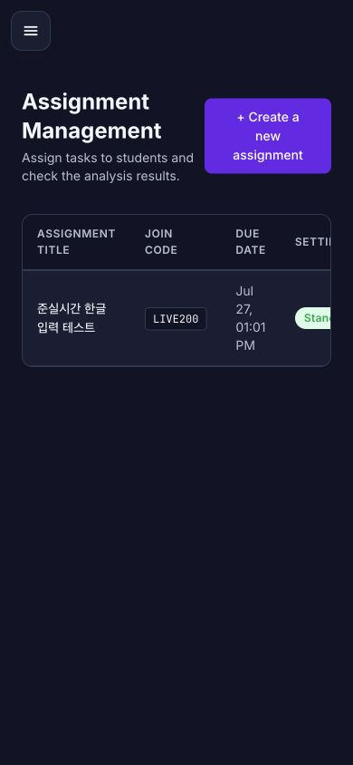

- The duplicate white logo bar is gone.
- A compact floating menu control preserves access to navigation without consuming a full header row.

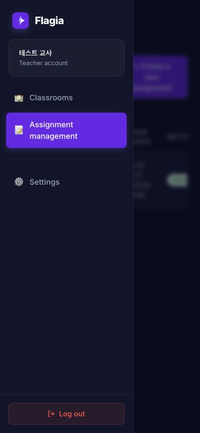

- The sidebar retains the single Flagia brand treatment.
- Usage guide is absent.
- Settings remains available and the page is dimmed behind the drawer.

## Localization and theme checks

- Vue I18n Korean and English catalogs cover all developer-owned frontend text.
- An English-mode DOM audit found Korean only in mock user-authored data: the teacher name and assignment title.
- Date output switches between `ko-KR` and `en-US`.
- REST and realtime errors expose stable codes so clients localize failures without relying on Korean prose.
- Frontend and backend production builds pass.
- No browser warnings or errors were produced in the verified flows.

---

# WebSocket session lock walkthrough

## Disconnected or rejected session

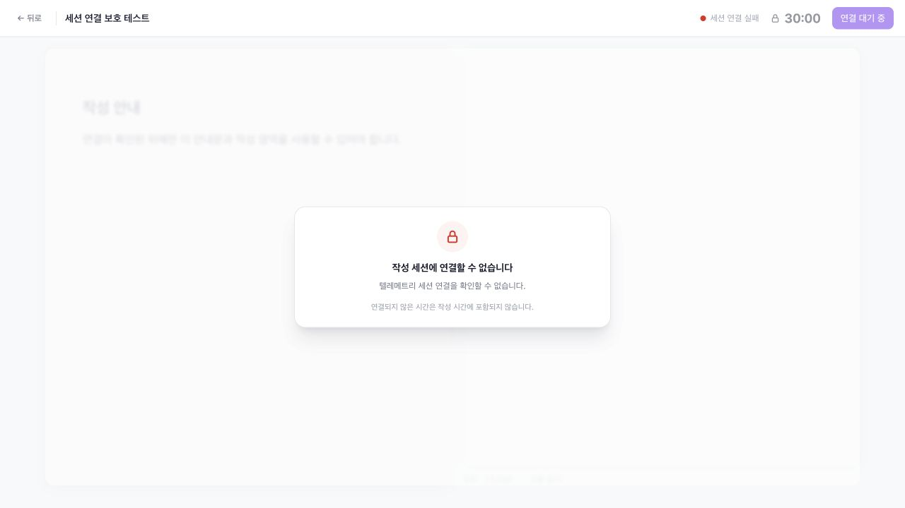

- The status remains red and reports the session failure instead of treating `auth_ok` as a complete connection.
- The timer displays a lock and remained at `30:00` throughout a 2.2-second observation.
- The template and writing pane are covered by a blocking overlay.
- The editor rendered with `contenteditable="false"`.
- The submit action remained disabled and displayed `연결 대기 중`.

## Confirmed session

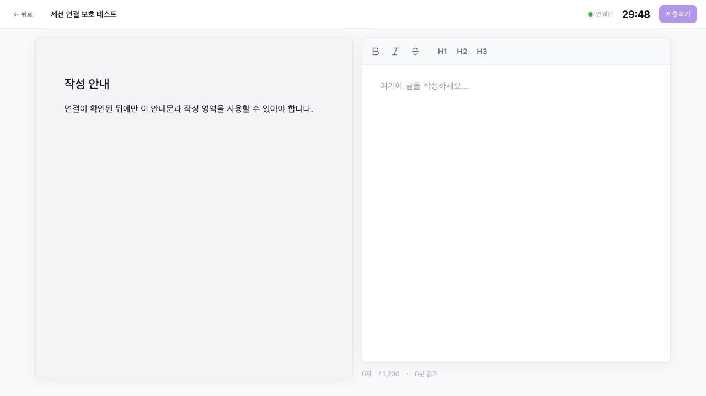

- The status turns green only after the server sends `session_ready`.
- The timer advanced from `29:54` to `29:52` during a 2.2-second observation.
- The template is readable and the blocking overlay is removed.
- The editor rendered with `contenteditable="true"`.

## Verification environment

The states above were exercised against a local WebSocket/API mock using an Admin identity. The disconnected case returned a session error after successful socket authentication; the connected case returned `session_ready`.

The active connection was also interrupted and restored:

- On disconnect, the overlay returned and the timer remained at `29:04` for a 2.2-second observation.
- After automatic reconnect and a new `session_ready`, the overlay cleared and the timer advanced from `28:57` to `28:55`.
- No browser console warnings or errors were produced during the tested states.

# 한국어 언어 분석과 실제 감점 — 2026년 10월 18일

기존 다섯 지표에 형태·구문 분류기와 문맥 분류기의 언어 감점을 연결했다. 의미 수정 후보는 전사 필터를 보완하며 언어 감점에 중복 반영하지 않는다. 감점은 분석 완료 즉시 적용한다.

## 점수와 근거

아래 화면은 실제 프런트엔드 빌드에 로컬 API 가상 제출물을 연결한 검증 화면이다. 실제 학생 글이나 실제 모델의 특정 글 판정 결과가 아니다. 95점에서 정책 감점 65점을 반영해 30점이 되는 계산, 두 분류 점수, 특징 기여도와 수정 전후 비교를 확인했다.

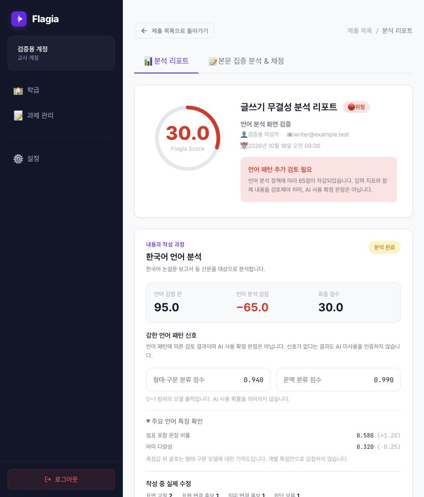

## 진행·실패·학생 권한

분석 중에는 점수가 잠정 점수임을 표시하고 완료 후 자동 갱신한다. API 응답을 완료 상태로 바꾸었을 때 새로고침 없이 95점에서 30점으로 바뀌는 것을 확인했다. 실패 시 미평가로 표시하고 언어 감점을 적용하지 않으며, 다시 분석 버튼으로 진행 상태에 진입한다.

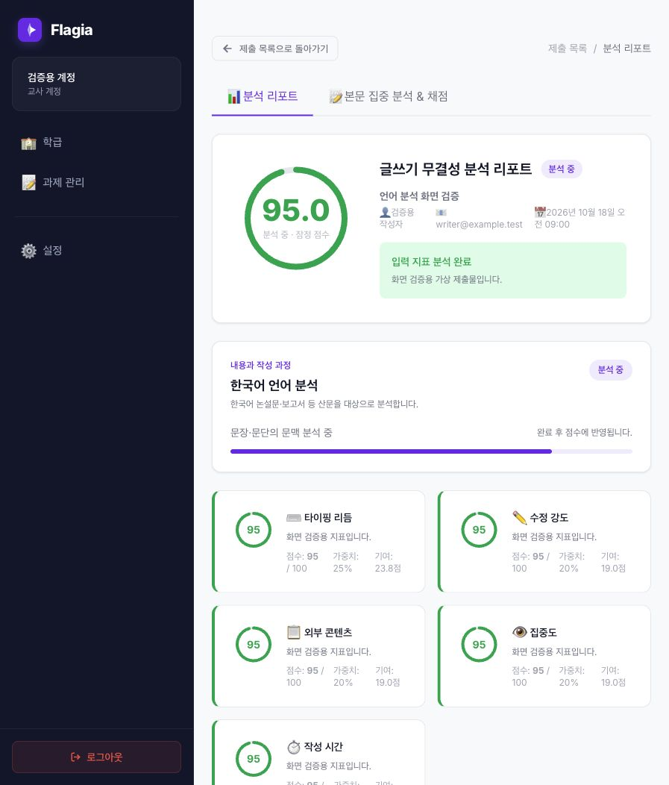

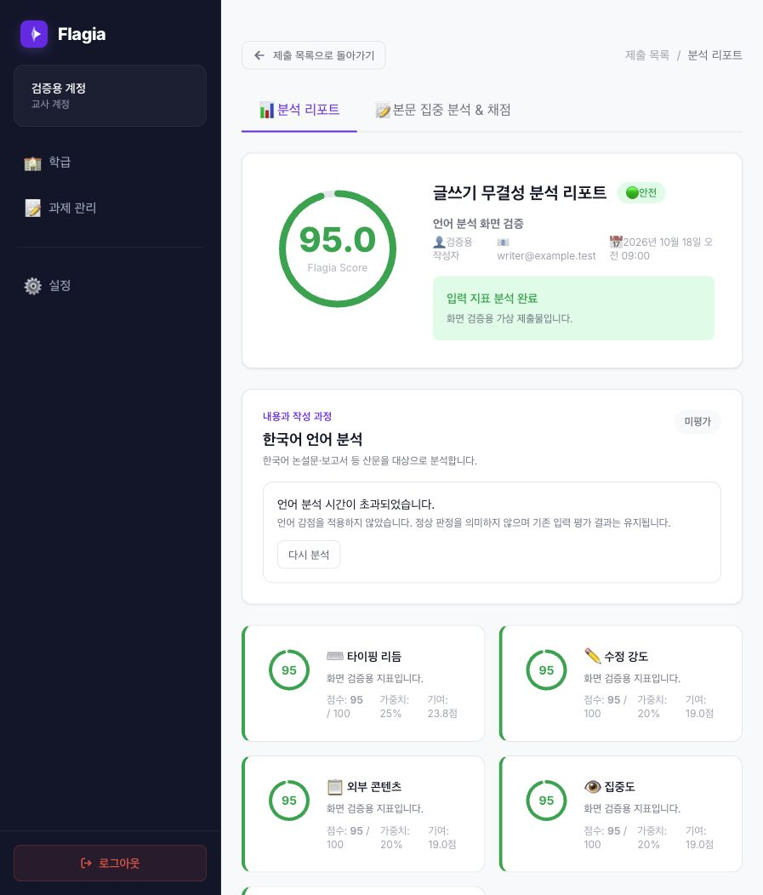

학생에게는 진행 안내와 점수·세션 요약만 보인다. 분류 점수, 임계값, 특징 및 수정 원문은 API 응답에서도 제외하는 검사를 통과했다.

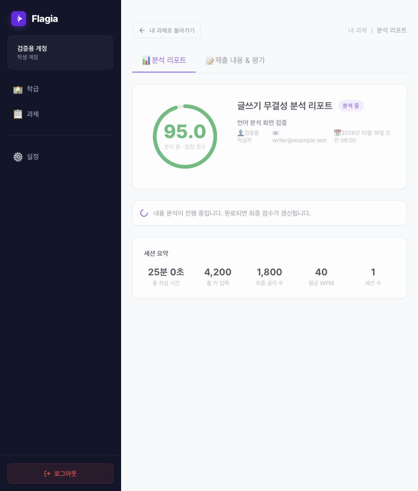

## 모바일과 영어

390px 너비의 뷰포트에서 확인했다. 기존 점수 카드의 고정 가로 배치가 설명을 잘라 내는 원인이어서 좁은 화면에서는 세로 배치로 바꿨다. 수정 후 콘텐츠 너비와 화면 너비가 모두 384px로 일치해 가로 넘침이 없었다. 한국어·영어 언어 카드와 새 판정·감점 문구를 확인했다.

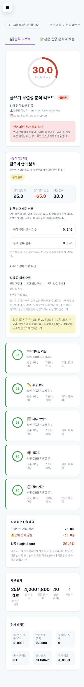

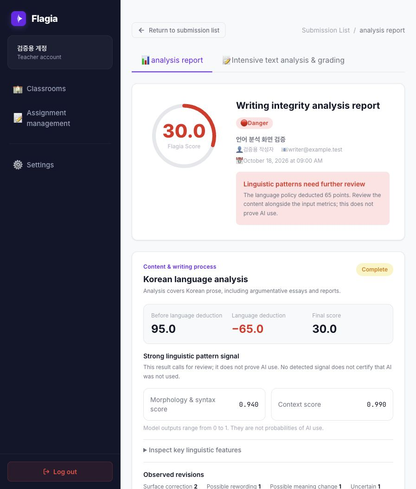

## 모델 학습과 성능 범위

공개 KatFish 논설문 자료로 형태·구문 로지스틱 분류기와 `klue/roberta-small`의 마지막 두 층 및 분류 헤드를 학습했다. 모델은 `ko-prose-692e52322b500fba`다. 실제 가중치는 로컬 `.linguistic-local/model`에 있고 원문 자료·가상환경과 함께 Git에서 제외한다.

| 구분 | 표본과 결과 |
|---|---|
| 학습 | 7개 주제, 234편: 정상 118편 + GPT-4o 116편 |
| 임계값 보정 | 별도 2개 주제 128편, 그중 정상 글 29편으로 임계값 설정 |
| 독립 주제 평가 | 별도 2개 주제, 정상 34편 + AI 112편 |
| 언어 감점 분기의 정상 글 오탐 | 0/34 |
| 언어 감점 분기의 AI 검출 | 66/112, 약 58.9% |
| 정상 글 띄어쓰기 교정 대조군 | 0/34 감점 |
| 형태·구문 / 문맥 AUROC | 0.96875 / 0.99842 |
| 짧은 글 실제 추론 통합 검사 | 최초 약 7.1초, 모델 상주 후 같은 글 약 42ms |

표본이 작다. 정상 글 34편에서 오탐 0건은 목표 오탐률 1%·0.1%를 입증하지 않으며, 동일 분포 독립 표본 가정에서도 단측 95% 상한은 약 8.43%다. 실제 작성 이력 전체를 결합한 오탐률, 깊은 인간 재서술, 혼합 작성, 보고서 장르 및 다양한 맞춤법 교정은 검증하지 않았다. 작성자 식별 자료가 없어 작성자 독립 평가도 주장하지 않는다. 현재 임계값은 초기 운영값으로 화면에 표시한다.

## 코드와 통합 검증

- 프런트엔드·백엔드 정식 빌드, 기존 엔진 검사, 문서 프레임 프로토콜 및 한국어/IME 재생 검사 통과.
- 0·15·35·65점, 경계값, 0점 하한, 실패 시 무감점, 중복 차감 방지와 학생 응답 제한 검사 통과.
- 한국어 부정·수량 변경, 띄어쓰기, 단일/중복 시각, 무수정 및 유한 특징값 Python 검사 6개 통과.
- 실제 로컬 모델의 비동기 진행·반복 추론·작업 취소 검사 통과.
- 실제 제출 finalizer와 분석 큐를 메모리 SQL 어댑터에 연결해 동시 제출/일괄 종료 충돌, 초기·최종 결과 저장, 점수 열 갱신, 다른 문서·모드·모델의 이전 작업 덮어쓰기 방지 검사 통과. 운영 SQL 데이터는 사용하지 않았다.

재현 방법과 초기 구현의 한계는 [운영 문서](flagia-backend/linguistic/OPERATIONS.md), 고정된 수치와 버전은 [모델 평가 기록](flagia-backend/linguistic/model-evaluation.json)에 있다.

# 언어 분석 안내 문구 정리 — 2026년 10월 18일

사용자가 지정한 아홉 안내 문구를 한국어·영어에서 정리했다. 여섯 안내 문단과 해당 화면 요소를 제거했고, 감점 내역·수정 분석·기록 표본 설명은 지정한 뒷부분만 삭제했다. 점수 계산과 분석 데이터는 변경하지 않았다.

아래 이미지는 현재 프런트엔드 프로덕션 빌드에 **로컬 가상 제출물**을 연결한 UI 검증 화면이다. 실제 학생 분석 또는 운영 환경의 탐지 성능을 나타내지 않는다. 함께 진행 중이던 기존 UI 스타일 변경도 화면에 포함되어 있다.

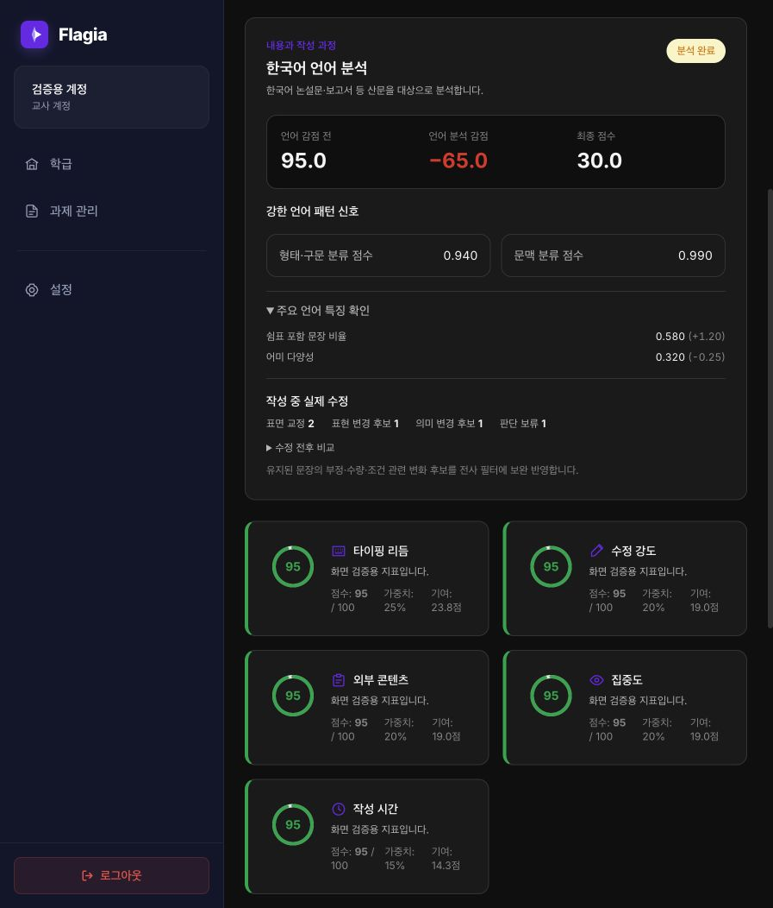

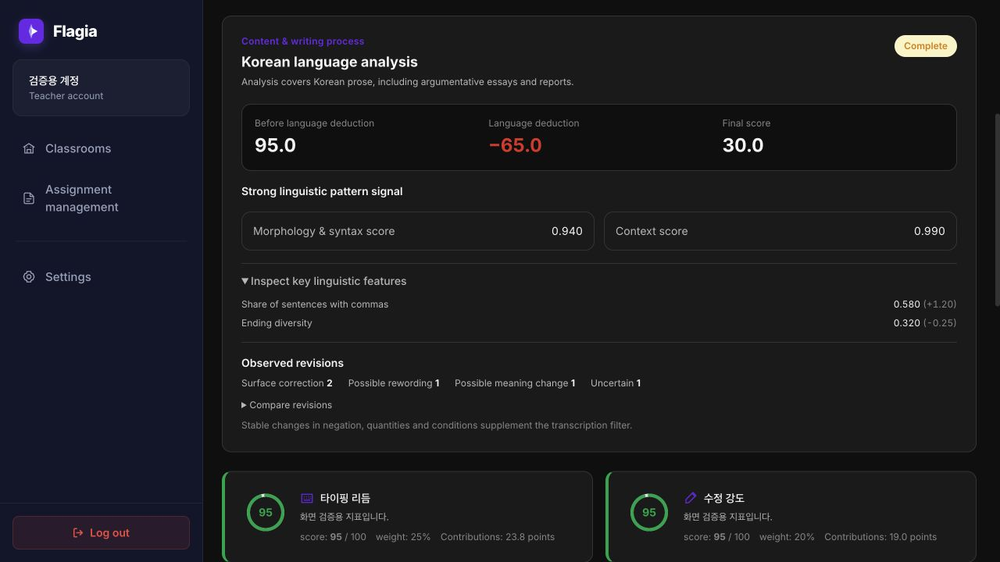

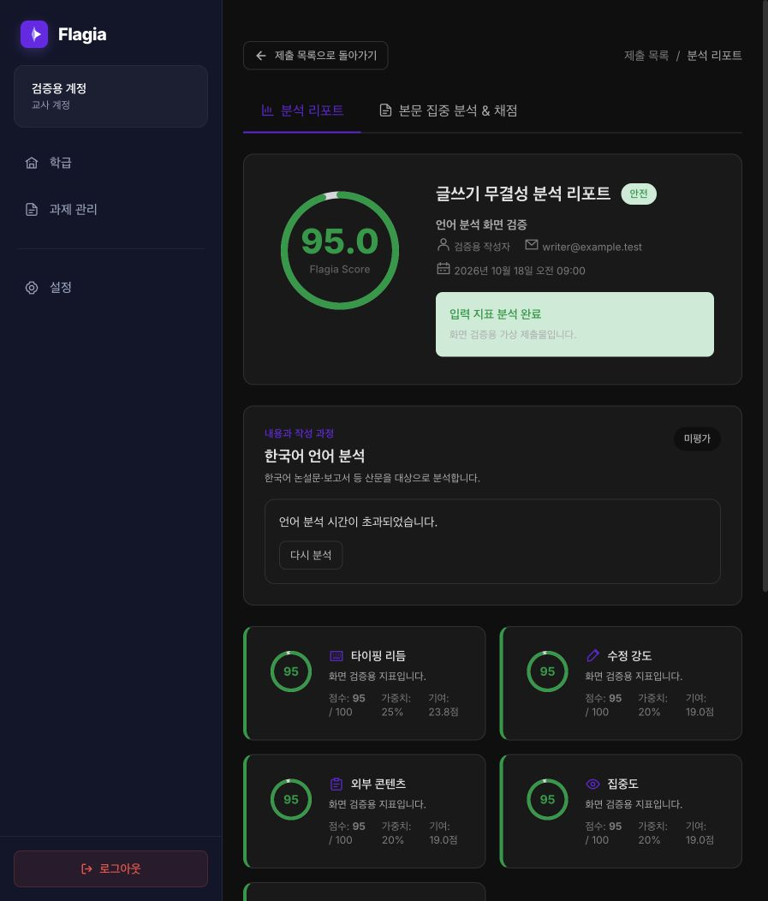

- `npm run build`: 타입 검사 및 프로덕션 빌드 통과.
- 한국어·영어의 분석 완료/미평가 화면 확인: 삭제 문구와 번역 키 노출이 없고, 빈 초기 기준 안내 박스가 남지 않는다.
- 특징 펼치기, 분류 점수, 수정 횟수, 미평가 사유 및 재시도 버튼이 유지되는 것을 확인했다.
- 가상 제출물의 감점 전 95점·감점 65점·최종 30점이 그대로 표시되었다. 감점 설명은 `언어 분석 정책에 따라 65점이 차감되었습니다.`로 표시된다.
- 브라우저 콘솔 경고·오류 0건. 임시 검증 서버와 브라우저 탭은 종료했다.
- 문구 정리의 로컬 검증 이후 후속 요청 `푸시 ㄱ`에 따라 해당 변경만 별도 커밋·푸시한다. 위 스크린샷에는 이번 커밋 범위에 포함되지 않는 다른 UI 스타일 작업도 보인다.
